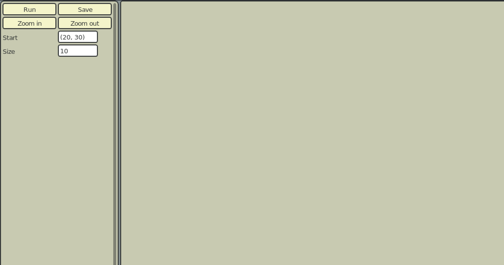
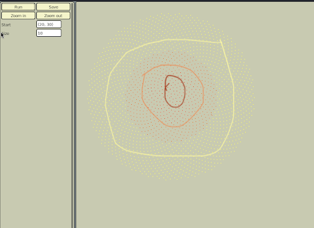
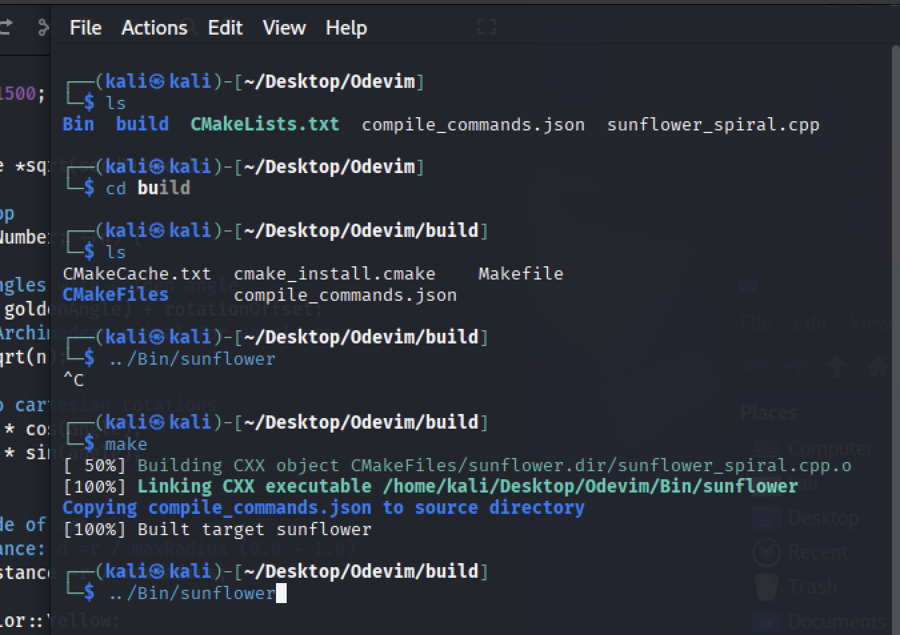
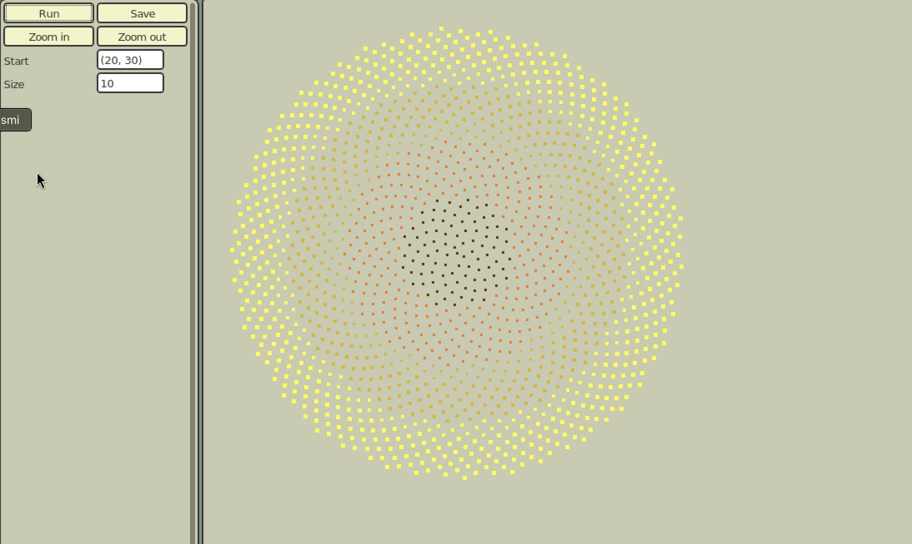
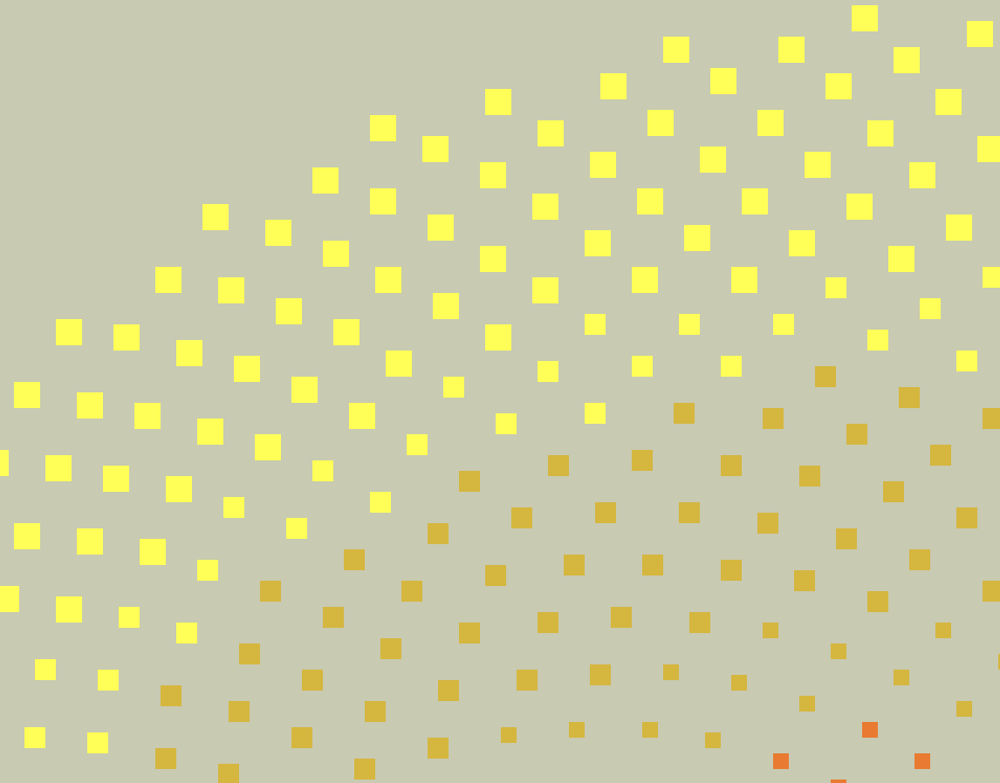

# Ayçiçeği spirali

Lefke Avrupa Üniversitesi Mühendislik Fakültesi'nde 2025 yılında aldığım COMP465 Advanced Computer Graphics dersinin dönem projesi. Konuyu dersin öğretim üyesi önerdi. Amaç, ayçiçeği çekirdeklerinin doğadaki dizilişini altın oran açısıyla bir animasyon olarak göstermek.

Çalışma Gorgon (Advanced Library) ile C++ içinde yazıldı. Ayrıntılar ve aşağıdaki görseller dönem raporundan alınmıştır. Raporun bu kopyasında öğrenci numarası ve öğretim üyesi adı çıkarılmıştır.

## Ne yapmak istedim

Önce gerçek ayçiçeklerine, renklerine, altın oran açısına ve formülüne baktım. Gerçek ayçiçeklerinde çekirdeklerin altın orana göre durduğunu, bu açının doğada en verimli yerleşim açısı olduğunu gördükten sonra işe koyuldum. Gorgon ve Advanced Library macOS'ta desteklenmediği için kurulumu kendi makinemde doğrudan yapamadım. UTM ile bir sanal makine kurdum, dağıtımı Kali Linux olarak seçtim ve kütüphaneyi orada çalışır hale getirdim. Formüller ve algoritmalarla animasyonu kurup derledim.

## Karşılaştığım sorunlar

Teknik tarafta spiral çizimi, kutuptan kartezyene dönüşüm, altın oran açısı, gradyan kuralları, çekirdek konumları, hız ve renk seçimi gerekiyordu. Bunlar ders ve ders notlarıyla ilerledi.

Asıl zorluk işletim sistemi tarafıydı. Silicon Mac'lerde (M1, M2) klasik VirtualBox verimli değildi. UTM ile önce Ubuntu denedim, çalışmadı. Başka bir Ubuntu sürümü açıldı ama Windows XP'den yavaş kaldı. Kali Linux beklediğimden iyi çalıştı; grafik ve görselleştirme için birçok paket kurmam gerekti. Öğretim üyesinin Advanced Library yükleme mesajından sonra Gorgon'u kurdum. Şablonda üç dosya vardı; ilk örnek, döngüyle düşen yeşil bir toptu.

## Çözüm ve parametreler

CGAnimation şablonunu çalıştırdıktan sonra şablonun algoritmasını ve ders notlarını taradım. Animasyon hızı için `mySpeed` değişkenini kullandım. Bu değer her karede 0.05 artar ve animasyon durmadan döner. Tuvali 600x600 piksel yaptım; Kali'de aksi halde animasyon çalışsa bile görünmüyordu. Merkez koordinatları 300x300, böylece spiral ortada başlıyor. Ölçek (`scale`) 7.0; görünür ve iyi bir sıklık için bu değeri seçtim.

Altın açı 137.508 derecedir, radyana `137.508 * (M_PI / 180.0)` ile çevrilir. Bu açı Fibonacci dizisinden gelir ve doğadaki en uygun paketleme açısıdır. Dönüş `rotationOffset = mySpeed * 10.5` ile çarpılır; bu çarpan hem hızı ayarlar hem de durmadan dönme etkisini verir. Çekirdek sayısı `seedNumber = 1500`. Daha azında bütün ayçiçeği görünmüyordu. Gradyanı, özellikle dördüncü bölgede, `maxRadius = scale * sqrt(seedNumber)` ile normalize ettim.

Her çekirdeğin yeri altın açı ve Arşimet spiraliyle bulunur: `r = scale * sqrt(n)`. Karekök kullanmamın sebebi çekirdeklerin eşit aralıkta durması. Kutupsal koordinatlar klasik dönüşümle kartezyene çevrilir: `x = merkezX + r * cos(açı)`, `y = merkezY + r * sin(açı)`.

Renk, merkeze olan normalize uzaklıkla (`r / maxRadius`) dört bölgeye ayrılır. 0.0 merkez, 1.0 dış çemberdir. Gerçek ayçiçeğine yaklaşmak için kahverengi, turuncu, altın ve sarı kullandım:

- 0–25: kahverengi (merkez)
- 25–50: turuncu
- 50–75: altın
- 75–100: sarı (dış halka)

Dıştaki çekirdekler `normalizedIndex` ile biraz daha büyük çizilir; bu da hafif bir derinlik hissi verir. Bu noktadaki yönlendirme öğretim üyesinden geldi. Sınır kontrolü olmadan program, özellikle Kali ortamında, çalışmıyordu. O yüzden çekirdek yalnızca tuvalin içindeyse kare olarak doldurulur: `dy` ve `dx` döngüsüyle `bitmap.SetRGBAAt` çağrılır. Görüntü `Redraw()` ile ekrana gelir.

## Sonuçlar ve deneme çıktıları

Görseller dönem raporunun Sonuçlar bölümünden alınmıştır.

Kurulumdan sonra gerekli grafik kütüphaneleri ve derleyici hazırdı. Program açıldı:



En belirgin başarısızlık ilk denemeydi. Raporda yazdığım gibi yalnızca üç bölge vardı (kırmızı, turuncu, sarı). Linux'ta bazı kurulumları unutmuştum, görüntü net değildi, kareleri düzgün göremedim ve program çöktü. Eksikleri kurduktan sonra, öğretim üyesinin yönlendirmesiyle animasyonu düzelttim:



Düzeltmelerden sonra kodu derledim ve bu kez doğru çalıştı:



Son hali: çekirdek sayısı ve hızı daha iyi görünüm için ayarlandı. Dört bölge (kahverengi, turuncu, altın, sarı) net görünüyor:



Animasyonun ayrıntısı:



Öğretim üyesinin söylediği gibi `application.cpp`, `main.cpp` ve `application.h` dosyalarını tek bir `sunflower_spiral.cpp` dosyasında birleştirdim.

## Ne öğrendim

Altın oran açısını kullandım, 1500 çekirdek ve 10.5 hız çarpanıyla ilerledim. Kutupsal koordinatlar, gradyan ve grafik uygulamalarını buradan daha net anladım. Doğru açıyı oturtmak, bölge renklerini seçmek, çökmeleri ve hataları ayıklamak zaman aldı. Teknik kısım notlardan öğrenilebiliyordu; asıl geliştiğim yer kurulum ve eniyileme oldu. Sanal makine kurulumu zordu ama öğreticiydi. Kurulum için açık bir README vardı, o dosya çoğu eniyileme sorununda işime yaradı. Şablonu ve fonksiyonlarını anladıktan sonra algoritmayı planladım. Yaklaşık bir ay sürdü. Sonuçta 1500 çekirdekli, altın orana uyan, dört bölgeli ve dönen bir animasyon çıktı.

İleride şekilleri değiştirebilir, daha gerçekçi animasyon ekleyebilir, çekirdek boyutu, sıklık ve hız için bir arayüz koyabilirim. Şu anda bunlar kodun içinden değişiyor. Farklı çiçek örüntüleri ve daha pürüzsüz görünüm için kenar yumuşatma (anti-aliasing) da aklımda.

## Kurulum ve derleme

Gorgon gerekir: https://github.com/darkgazeorg/Gorgon

Linux'ta (derste Kali kullandım):

```bash
mkdir build && cd build
cmake ..
# Gorgon başka bir klasördeyse:
# cmake .. -DGORGON_ROOT=/path/to/Gorgon
make
./sunflower_spiral
```

Pencerede Run, Save, Zoom in ve Zoom out düğmeleri var. Animasyon her karede kendiliğinden güncellenir. Çekirdek sayısı ve hız şu anda kodun içinden değiştirilir.

macOS'ta Gorgon doğrudan kurulmadığı için bir Linux sanal makinesi gerekir. Silicon Mac'te VirtualBox iyi çalışmadı; UTM ile ilerledim.

Bu taslağı hazırlarken ortamda Gorgon yüklü değildi, programı burada yeniden derleyip çalıştıramadım. Yukarıdaki görseller kendi Kali ortamımdaki dönem çıktılarıdır.

## Dosyalar

- `sunflower_spiral.cpp` — animasyonun kaynak kodu. Öğrenci numarası satırı çıkarıldı. Kaynakta `rotationOffset` yazımında bir typographic ligature vardı (`ff`); derlenebilir olsun diye normal `ff` yapıldı.
- `CMakeLists.txt` — derleme dosyası. Orijinal ödev klasöründe yoktu; Gorgon'un `find_package` kullanımına göre yazıldı.
- `docs/Sunflower-Spiral-Report.pdf` — dönem raporu (öğrenci numarası ve öğretim üyesi adı çıkarılmıştır)
- `docs/figures/` — raporun Sonuçlar bölümündeki deneme çıktıları

## English

This is my COMP465 Advanced Computer Graphics term project at the European University of Lefke (2025). It is a sunflower-seed animation written in C++ with the Gorgon library. The topic was suggested by the course instructor. Gorgon is not supported on macOS, so I built it in a Kali Linux virtual machine under UTM after Ubuntu proved too slow or failed to run.

The program draws 1500 seeds on a 600x600 canvas, centred at (300, 300). Each frame increases `mySpeed` by 0.05; rotation is `mySpeed * 10.5`. Seed positions use the golden angle 137.508 degrees, converted to radians, and an Archimedean spiral `r = 7.0 * sqrt(n)`. Polar coordinates are converted to Cartesian. Colour follows four radial zones by `r / maxRadius`: brown (0–25), orange (25–50), gold (50–75) and yellow (75–100). Outer seeds are drawn slightly larger. A bounds check was required, otherwise the program crashed on Kali.

The first run showed only three zones (red, orange, yellow), looked unclear and crashed because of missing Linux setup. After installing the missing pieces and compiling again, the four-zone spiral ran correctly. The figures in `docs/figures` are taken from the Results section of the term report. The instructor asked me to merge `application.cpp`, `main.cpp` and `application.h` into a single `sunflower_spiral.cpp`.

Build with CMake after installing Gorgon. The student number and the instructor's name have been removed from this copy of the report. I could not rebuild the program in the draft environment because Gorgon was not installed there.
